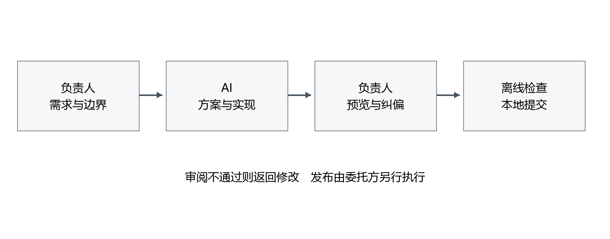
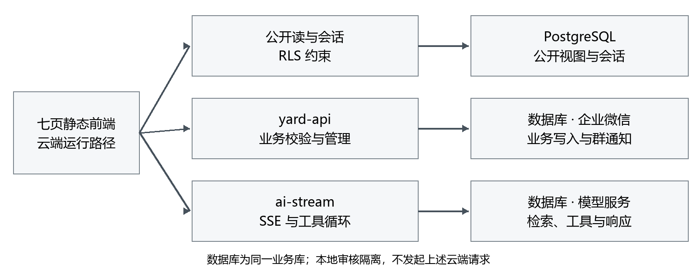
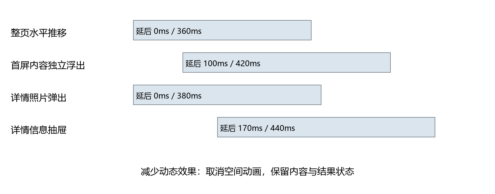

# 成都猫狗小院技术文档

2026 第九届传智杯全国大学生数智创新与 AI 应用大赛

AI创新应用挑战赛

## 一 项目目标与范围

成都猫狗小院领养平台连接公开档案、访客申请、管理员处理与回访，目标是减少咨询中反复确认条件的成本。负责人借助 Codex 与 Harness 开发软件，负责业务意图、约束、审阅与验收；AI 提供方案、实现和检查，并接受实际反馈后的修正。

本文按新赛道的过程可复现性、实用价值、意图控制、工程架构与体验要求组织。规则来源是博学谷赛道 10039 网页，读取日期 2026-10-18；不再套用旧 AI WEB 赛道的框架要求和评分表。

### 1.1 业务闭环

访客需要了解动物特点，也需确认住所、家人意见及陪伴条件。平台提供公开资料、自然语言匹配和申请表单；管理员结合原始资料、AI 摘要和电话沟通决定下一步，领养后维护回访档案。AI 不自动批准申请，也不从照片判断健康事实。

平台没有量化证明领养率已经提高，因此目标不能写成成效。照片相似不代表适合领养，回答流畅也不代表事实已核实。界面应呈现依据、缺口和失败，不隐藏不确定性。

### 1.2 时间与交付边界

已恢复的基础需求对话始于 2026-08-17；仓库最早代码快照为 2026-09-06。基础版本也是负责人引导 Codex 开发，不能写成没有 AI 参与。Harness 的可见记录覆盖 2026-09-11 至 2026-10-18，后续多页与交互动效主要由 Codex 实现。

早期需求不能逐步对应到现有 Git；不补造提交、不把多月迭代叙述成一天从零构建。本轮仅交付本地源码与说明，不含发布同步、云端部署和真实模型验收。基础版本日期的资格适用问题仍需主办方确认。

## 二 意图控制与人机协作

### 2.1 将偏好转成可验证约束

负责人先描述使用问题，再细化为约束：长页拆独立页面、普通链接导航、先本地审阅、不由 Codex 发布、离线测试不得消耗模型额度。界面先局部预览，审阅后才应用全站，不能仅凭 AI 自评认定完成。

约束被写入 AGENTS.md，并通过结构和行为测试固定下来。交接文件只用于本地协作，不能覆盖负责人后来的限制。测试曾只分离线和线上，负责人指出线上只读与写入风险不同；文档也曾被过早修改，最终要求代码定稿、检查和提交后再统一同步。

表 1 核心迭代与人的决策

| 案例           | 人的控制与反馈                                   | 提交定位                  |
| -------------- | ------------------------------------------------ | ------------------------- |
| 多页与测试分档 | 要求独立页面、本地审核；纠正线上副作用分组       | 598b352、06f5607          |
| 方向转场与慢图 | 选择水平推移；指出返回方向、慢图阻断与浮出不明显 | a4601fb、f6751b6、fc640d5 |
| 按钮交互       | 先独立预览，再授权正式应用；反馈必须真实         | a7cb612                   |
| 管理员权限     | 从删除失败追查到管理通道                         | 232e1cc、0a6464e、e637f8c |
| 摘要保存       | 实际重开后发现重复生成，要求持久化               | dcb818c                   |

这些提交可用 git show 核对。Git 作者来自本机配置，不能据此判断具体 AI 工具归属；会话、文件内容和变更要交叉验证。

图 1 意图到验收的协作顺序

负责人表达目标和边界，AI 实现，负责人审阅反馈，检查通过后本地提交；发布权独立。图示不表示每一轮都一次成功。

### 2.2 原始证据与缺口

本地合并保留 1,189 条可见消息：用户 198 条、助手 991 条；Codex 来源 306 条，Harness 来源 883 条。按稳定身份未发现跨侧共享身份或冲突；七组相同文本但身份不同的记录保留待核对，不因“继续”等重复文字删除真实回合。

Codex 本机日志用固定字节前缀及 SHA-256 溯源；早期接口记录保留会话、回合 ID 和分页结束状态，没有底层文件哈希。Harness 来源为 .dsh 压缩帧导出，合并保留其清单，不声称重新验证了原始解压器。早期只有回合时间时，按回合开始排序，并保留时间精度限制。

原文保留失败、中断和纠偏，不根据成品补写 Prompt。图片和工具日志未完整导出；规则脱敏不等于人工隐私审核。完整链目前留本地审阅，负责人仍须逐链复核并提供评审可访问的证据包。本节摘要不替代赛事所需至少三条完整原文链。

## 三 架构与数据边界

### 3.1 原生多页与共享模块

七个静态 HTML 分别承载首页、寻找伙伴、AI 匹配、领养流程、回访故事、小院介绍和管理员工作台。原生 JavaScript 与 CSS 无构建步骤，普通链接与相对资源允许独立访问。初始化检查宿主元素，其他页节点缺失不应导致脚本中断。

表 2 主要模块分工

| 模块                | 负责                             | 不负责                 |
| ------------------- | -------------------------------- | ---------------------- |
| app.js              | 档案、弹层、申请、后台与 AI 交互 | 持有模型服务端密钥     |
| site-config.js      | 匿名配置与本地审核隔离           | 将示例草稿同步云端     |
| page-transitions.js | 方向、内容快照与清理             | 拦截链接重建路由       |
| button-feedback.js  | 按压与结果呈现                   | 调用额外业务或制造成功 |
| yard-api            | 业务校验、管理动作与通知         | SSE 输出               |
| ai-stream           | SSE、工具循环、文本和视觉检索    | 自动批准申请           |

图 2 系统通道与权限分工

公开读、业务写与模型请求分开。本机审核不连接图中的真实云服务。

### 3.2 业务与权限

yard-api 是 Event 云函数，ai-stream 是 HTTP 云函数，配置超时分别为 15 秒与 60 秒。AI 较长生成过程不应占据业务网关，模型不可用不应阻止人工处理申请。

匿名读取受 PostgreSQL RLS 约束，不能直写申请。管理动作先校验管理员身份，再由服务端特权通道执行，不能把前端隐藏按钮当权限控制。数据库演进以 cloudbase/migrations 为准，网关策略在 cloudbase/policy。

申请提交校验字段并使用蜜罐、最短填写时长和多维限频。自助修改采用 32 字节随机令牌，仅存哈希、24 小时有效；可写字段白名单阻止更改宠物、申请类型或管理员状态。群通知失败不能让已保存申请变成失败，也不得泄露内部备注、令牌或来源标识。

模型 Key、机器人地址、平台临时凭据不得进入公开代码。CloudBase 匿名可发布密钥不是管理密钥。会话和截图可能包含申请人资料，不能未经审查公开。

## 四 AI 能力与降级

### 4.1 工具调用与知识检索

访客模型可检索知识、筛选宠物、读取档案、政策和回访、对照条件缺口。工具只返回公开资料，不允许按联系方式查申请。缺口检查判断是否提到信息，不等于是否适合领养。

对话最多保留八条上下文消息，单条上限 600 字符，输出预算 900 token；工具循环最多三轮，最后一轮关闭工具以收口。单工具有超时限制，结果截断后进入上下文。界面允许停止，错误时保留可读的已返回内容，不能因出现部分文字便认定完成。

knowledge.js 按资料字段切块，单块最多 600 字符，每批最多 16 条向量化，默认取四条片段，过滤低于 0.3 的相似度并提供来源。查询先检查新鲜度，必要时重建；这会调用模型和写索引，搜索不天然等于只读。

资料不足时明确提示；向量失败返回降级信号，由上层采用备用路径。不承诺并发与故障下索引永远最新，也不把关键词备用检索称为同等语义能力。

### 4.2 管理员审核与多模态

审核助手围绕当前申请汇总摘要、缺口与追问建议，不自动更改状态。重复投递查询不向模型展开其他人的联系方式。摘要能显示不代表能保存，真实使用反馈推动持久化修正；规则兜底与真实模型生成必须区分。

照片最长边先压到 768px。管理员视觉描述只提供可编辑的外观初稿，不推断疾病、绝育或疫苗。访客图搜使用 2048 维视觉向量、0.5 最低相似度，按宠物去重并限制候选照片；相似不等于同一只或适合领养。

服务端抓取站内图片前检查域名和数据库路径，避免任意 URL 抓取。访客查询图不写对象存储，但仍会交给模型处理，不能称为从未离开设备。

Web Speech API 将识别文字放入输入框，由人确认后发送；朗读使用浏览器语音合成。不支持或无权限时降级，浏览器可能联网识别；本地审核停用识别，不伪造录音成功。

## 五 交互动效与可访问性

### 5.1 方向性跨文档转场

page-transitions.js 使用 pageswap、pagereveal 和真实导航来源、目标比较主导航页序。向较大页序导航，新页从右进入、旧页向左退出；向较小页序反向。历史返回比较两端，不固定设为向右。

同页筛选、锚点、刷新、站外或无法确认来源时不强制推移。浏览器隐藏来源地址时，只临时保存页序和来源条目键，用后清除，不保存完整地址或表单。存储或 API 不可用时继续普通导航。

根快照移动 360ms，最多六块首屏内容同步横移，延后 100ms 开始 420ms 浮出，总长约 520ms。两者重叠，不是先等一轮再开始下一轮。图片采用非阻塞加载，逻辑不以图片完成状态为启动门槛；完成、跳过或中断后恢复命名，避免污染历史缓存。

### 5.2 照片抽屉与表单

七页宠物详情共用照片抽屉。照片弹出 380ms；信息面板延后 170ms、持续 440ms 上推，覆盖照片下沿 34px。移动端保留安全区与可滚动详情。

对话框保留 Esc 关闭、Tab 焦点循环、关闭后焦点恢复和背景滚动控制。切到申请表单时重置滚动，使用居中限宽布局，修复原先内容偏左的问题。

### 5.3 按钮按压与真实结果

主要按钮缩到 0.96，释放回弹 280ms；后台、关闭和筛选采用 0.98、140ms。独立 scale 不覆盖布局 transform，不额外触发 click、不取消正常事件、不延迟业务以等待动画。

拖出、滚动、触摸取消、失焦和隐藏均清理状态。键盘保留控件语义，链接 Space 不冒充点击；共享监听兼容动态按钮。成功和失败来自业务回调，不按计时器猜测；部分回复后流错误不得庆祝，主动停止恢复普通状态，完整匹配才允许成功爪印。

图 3 动效时间与降级关系

时间条描述界面动画，不代表业务等待时长；加载持续到真实结果，未为它设置固定成功时刻。

### 5.4 减少动态效果

prefers-reduced-motion 为 reduce 时关闭空间推移、抽屉弹出、回弹和爪印，保留正文、颜色、结果与操作。没有原生转场时内容默认可见，直接普通导航，不依赖动画结束才能展示。

按钮交互中偏好发生变化也清理临时状态。转场、抽屉和反馈共享这一原则，不只对首页装饰降级。

## 六 素材与工程检查

assets 优化前 20,907,223 字节，优化后 1,999,666 字节，约减少 90.4%，低于 3,000,000 字节。四张照片、五张插画用质量 85 转 WebP，不缩尺寸且保留透明通道；零引用 adoption-companions.png 从站点移除，可从 Git 或本地备份恢复。

SVG、原始狗群照片和其他 JPEG 不重编码。文件体积不等于公网首屏性能，本轮未测移动网络，不能据此报告耗时收益。

check-multipage 已有 HTML 路径检查，本轮保留。check-assets 扩展 CSS url、JS 固定素材和 HTML 图片及 srcset，并检验大小写、编码、越界和预算。动态云端 URL 不纳入本地存在性结论。

## 七 复现与测试证据

### 7.1 本地复现

建议 Node.js 24 LTS 与 npm，npm ci 后运行 npm run preview:local，在 127.0.0.1:4173 访问七页。服务仅提供公开文件白名单。云函数配置的 Nodejs20.19 与本地工具环境分开说明。

审核不加载 CloudBase SDK，不提交申请或调用 AI、图搜、语音识别；示例草稿在当前浏览器保存。安装、字体和示例图片可能联网，不将网页误称为完全离线。

README 提供十分钟路径、依赖和环境模板，但全新机器计时尚未做；云端初始化不包含在该目标内。模型重跑不保证逐字生成相同代码，可验证的是固定版本运行、离线检查和开发记录溯源。

表 3 默认离线测试输出

| 脚本                      | 项数或组数 | 覆盖                         |
| ------------------------- | ---------- | ---------------------------- |
| check-admin-settings      | 16 项      | 管理表单                     |
| check-multipage           | 331 项     | 七页职责、导航与资源         |
| check-assets              | 42 项      | 素材存在性与预算             |
| check-ui-redesign         | 175 项     | 视觉结构与审定原图           |
| test-page-transitions     | 17 组      | 方向、慢图、内容与降级       |
| test-button-feedback      | 25 组      | 指针、键盘、结果与取消       |
| test-local-review         | 28 项      | 审核隔离、抽屉、表单与白名单 |
| check-repo-compliance     | 31 项      | 密钥、文档、提交与整洁       |
| test-knowledge            | 23 项      | 切块、索引、过滤与失败       |
| test-vision-guards        | 15 项      | URL 与路径限制               |
| test-tc3-signing          | 51 项      | 签名与修改令牌               |
| test-wecom-notify         | 56 项      | 通知资料与失败处理           |
| test-admin-applicant-edit | 24 项      | 字段白名单与校验             |

### 7.2 验收范围

这些数字来自本轮执行，“组”不等于单断言。素材与归拢阶段 npm test 约 7.8–7.9 秒，受设备和历史数量影响。模拟通知失败是分支输入，不代表给真实企业微信发消息。

每次提交还执行 lint、format:check、多页和仓库合规检查。临时会话及渲染产物不作为站点源码扫描，tools 中的真实测试全部保留。

test:online 只包含发布同步与 AI 预览只读检查。test:live 包含申请探针、真实聊天、工具与匿名写探针，可能写云端或消耗额度，仅委托方部署后执行。本轮均未运行，发布状态另行验收。

合并校验核对数量、身份、原文、顺序、输入哈希和常见敏感模式，不代表原图、完整日志和隐私人审齐备。正式 Word 和 PDF 生成后另行核对目录、嵌入字体、编号及逐页布局，不在生成前预填成功结论。

## 八 发布与参赛交付

代码、仓库归拢和正式材料分批本地提交，保留真实纠错；内部指令、截图和会话不进入当前公开索引。移出索引不等于删除本地或抹除旧历史。

委托方指定 Harness 同步 release 并发布前端；Codex 维护源码、测试、文档及 GitHub，授权后推送，不改 release 或部署。发布须同步七页、四个 JS、样式及 WebP。CI 以只读权限运行五项源码检查，不运行线上测试或部署，也不能证明线上业务可用。

本赛道为个人赛，姓名、学校、组别和指导教师须负责人核实。完整原文证据包仍需人审与访问授权；视频要求 5–8 分钟 MP4 1080p，至少两分钟展示真实协作。

尚未完成新机器计时、完整会话包公开审查、视频与本轮线上验收。官方页部分赛程及国赛奖项比例前后不一致，应咨询主办方，不据此保证资格或成绩。

## 参考来源

1. 博学谷 AI创新应用挑战赛详情，https://www.boxuegu.com/matchTrack/detail/?id=10039 ，2026-10-18 浏览器读取。
2. 本仓库 AGENTS.md、package.json、七页 HTML、共享脚本与 styles.css。
3. functions/yard-api、functions/ai-stream、cloudbase/migrations 与 cloudbase/policy 实际源码。
4. Codex 与 Harness 本地可见会话及来源清单；原文须授权，不含内部推理或未经批准的私人资料。
